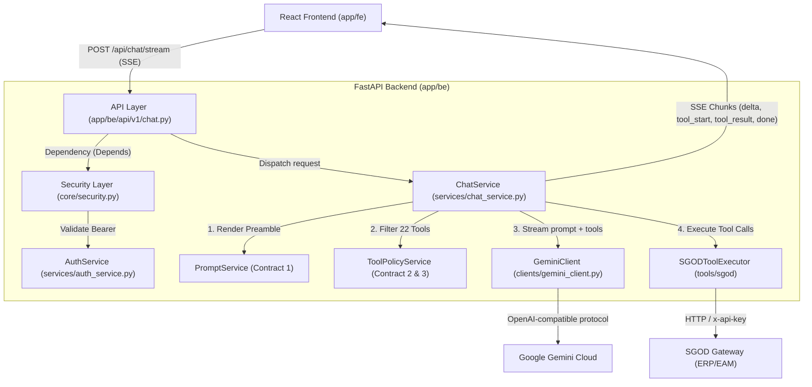

# Báo cáo Thiết kế Kiến trúc & Kỹ thuật Backend ChatSystem (`app/be`)

> **Tài liệu Kỹ thuật dành cho Mentor / Tech Lead**  
> **Dự án:** SGOD AI Assistant — Trợ lý ảo AI đàm thoại & Thực thi công cụ nghiệp vụ  
> **Phiên bản:** 2.0.0 (Clean Architecture & Full Streaming SSE)  
> **Tech Stack:** Python 3.14+, FastAPI, Google Gemini (OpenAI protocol), Pydantic v2, Server-Sent Events (SSE)

---

## 1. Tổng quan Hệ thống (System Overview)

Backend `app/be` đóng vai trò là **Hệ thống Điều phối Trung tâm (AI Orchestration & Security Gateway)** giữa giao diện người dùng React Frontend (`app/fe`), mô hình trí tuệ nhân tạo tạo sinh Google Gemini, và Cổng dịch vụ nghiệp vụ **SGOD Gateway** (ERP/EAM).

Hệ thống không chỉ đóng vai trò là một REST API thông thường, mà là một **Agentic Tool-Calling Proxy** có khả năng:
- Xác thực và ủy quyền đa tầng (Multi-tier Authentication).
- Thực thi vòng lặp Agentic (LLM quyết định gọi công cụ $\rightarrow$ Backend thực thi vào SGOD $\rightarrow$ Trả kết quả cho LLM tổng hợp).
- Truyền tải dữ liệu thời gian thực theo định dạng Server-Sent Events (SSE) cho trải nghiệm người dùng liền mạch.
- Bảo vệ toàn diện các khóa bí mật hệ thống và áp dụng chặt chẽ chính sách phân quyền vai trò (RBAC).

---

## 2. Kiến trúc Phân tầng (Layered Clean Architecture)

Sau đợt tái cấu trúc, toàn bộ mã nguồn `app/be` được tổ chức lại theo nguyên lý **Separation of Concerns (SoC)**, **Single Responsibility Principle (SRP)** và mô hình **Clean Architecture**:

```
app/be/
├── core/                        # [Tầng Cốt lõi & Hạ tầng dùng chung]
│   ├── config.py                # Quản lý cấu hình, biến môi trường (.env) và đường dẫn file
│   ├── security.py              # Dependency kiểm tra token JWT Bearer & phiên làm việc
│   └── __init__.py              # Barrel export cho core
├── schemas/                     # [Tầng DTO / Models]
│   ├── auth.py                  # Schemas xác thực: LoginRequest, UserContext, LoginResponse...
│   ├── chat.py                  # Schemas hội thoại: ChatRequest, ChatMessage, ToolExecutionRecord...
│   ├── health.py                # Schema kiểm tra sức khỏe hệ thống: HealthResponse
│   └── __init__.py              # Barrel export gom toàn bộ schemas
├── clients/                     # [Tầng Adapters / External Integrations]
│   ├── sgod_client.py           # HTTP Client giao tiếp với SGOD Gateway (URLLib/HTTP)
│   ├── gemini_client.py         # Client giao tiếp Google Gemini (OpenAI Streaming protocol & Fallback)
│   └── __init__.py              # Barrel export cho clients
├── services/                    # [Tầng Logic Nghiệp vụ Độc lập - Core Business Logic]
│   ├── auth_service.py          # Nghiệp vụ đăng nhập đa tầng, UserContext theo Contract 3
│   ├── chat_service.py          # Điều phối vòng lặp Agentic Streaming loop & bộ xử lý SSE
│   ├── prompt_service.py        # Render template preamble theo slot (Contract 1)
│   ├── tool_policy_service.py   # Lọc 22 tools SGOD theo vai trò người dùng (Contract 2 & 3)
│   └── __init__.py              # Barrel export cho services
├── api/                         # [Tầng Trình bày - Presentation Layer / FastAPI]
│   ├── deps.py                  # FastAPI Dependency Injection (Inversion of Control)
│   ├── router.py                # Router trung tâm tổng hợp các domain routers
│   ├── v1/                      # API phiên bản v1
│   │   ├── auth.py              # Router /api/auth (login, refresh, me)
│   │   ├── chat.py              # Router /api/chat (stream SSE)
│   │   ├── health.py            # Router /api/health
│   │   ├── tools.py             # Router /api/tools (discovery danh mục tool theo vai trò)
│   │   └── __init__.py          # Barrel export router v1
│   └── __init__.py              # Barrel export cho api
├── __init__.py
└── main.py                      # Application Factory, CORS Middleware & Server Entrypoint
```

### Sơ đồ Luồng Dữ liệu (Architecture Flow)



---

## 3. Vai trò Proxy của Backend (Tại sao cần Backend làm Proxy?)

Nếu Frontend gọi trực tiếp tới SGOD Gateway hoặc Google Gemini, hệ thống sẽ gặp các rủi ro bảo mật nghiêm trọng. Backend đóng vai trò **Reverse Proxy & Security Gateway** với các nhiệm vụ:

1. **Bảo mật Tuyệt đối Khóa bí mật (Secrets Protection)**:
   - Toàn bộ `GEMINI_API_KEY`, `SGOD_AUTH_API_KEY`, `SGOD_ASSET_API_KEY`, `SGOD_CHAT_API_KEY` được lưu trữ an toàn trong biến môi trường server (`.env`). Trình duyệt người dùng không bao giờ nhìn thấy các API Keys này.
2. **Cơ chế Thử nghiệm Phiên đa tầng (Multi-tier Probing)**:
   - Hệ thống tài khoản SGOD chia thành 3 tầng: `enterprises` (doanh nghiệp mẹ), `enterprise-users` (nhân viên doanh nghiệp), `sub-enterprises` (doanh nghiệp con).
   - Khi người dùng đăng nhập không chỉ định tầng, `AuthService` tự động thăm dò theo thứ tự ưu tiên:
     $$\text{enterprises} \longrightarrow \text{enterprise-users} \longrightarrow \text{sub-enterprises}$$
   - Giúp trải nghiệm người dùng liền mạch (1 form đăng nhập duy nhất).
3. **Chuẩn hóa Ngữ cảnh Người dùng (Contract 3 Compliance)**:
   - Backend trích xuất dữ liệu thô từ SGOD, loại bỏ hoàn toàn các trường nhạy cảm (tenant id, password băm, metadata nội bộ), chỉ đóng gói thành canonical `UserContext` (`user_id`, `role`, `tier`, `full_name`, `role_vi`).
4. **Kiểm soát Truy cập Dựa trên Vai trò (RBAC Gatekeeper)**:
   - Backend chặn việc gọi các tool nằm ngoài quyền hạn của người dùng (ví dụ: nhân viên thường `employee` không bao giờ được phép nhìn thấy hoặc thực thi các tool như `get_enterprise_profile` hay `list_enterprise_users` của `company_admin`).
5. **Tự động Phục hồi Phiên (Transparent Token Refresh)**:
   - Khi đang thực thi một chuỗi công cụ trong SGOD Gateway mà `access_token` bị hết hạn (HTTP 401), Backend tự động dùng `refresh_token` để xin cấp lại token mới và tiếp tục hoàn tất câu lệnh mà người dùng không bị gián đoạn.

---

## 4. Các Tính năng Cốt lõi & Cơ chế Hoạt động Chi tiết

### 4.1. Vòng lặp Agentic Tool-Calling Real-time (100% SSE Streaming)

Luồng hoạt động khi người dùng đặt câu hỏi *"Cho tôi xem danh sách tài sản của tôi"*:

1. **Gửi yêu cầu SSE**:
   Frontend mở kết nối `POST /api/chat/stream`.
2. **Render System Preamble (Contract 1)**:
   `PromptService` đọc file template `prompts/system_preamble_v1.txt` và thay thế chính xác các slot bằng chuỗi nguyên bản:
   `{role}`, `{role_vi}`, `{full_name}`, `{user_id}`.
3. **Phân quyền Công cụ (Contract 2 & 3)**:
   `ToolPolicyService` đọc `sgod_tools.json` và `tool_policy.json`, chỉ nạp danh sách các tool mà role của user được phép gọi, chuyển đổi về định dạng OpenAI Function Calling.
4. **Vòng lặp Agentic Multi-turn**:
   - Backend gửi prompt + tools sang Gemini với cờ `stream=True`.
   - Backend nhận chunks stream và phát sự kiện `event: status` (*"Đang phân tích yêu cầu..."*).
   - Khi Gemini quyết định gọi tool (ví dụ: `list_my_assets({"limit": 5})`):
     - Backend phát sự kiện `event: tool_start`.
     - `SGODToolExecutor` gọi Gateway SGOD với Bearer Token của người dùng.
     - Backend phát sự kiện `event: tool_result` kèm trạng thái thực thi và dữ liệu trả về.
     - Đưa kết quả của tool trở lại lịch sử hội thoại dạng `{role: "tool", content: "..."}` và kích hoạt turn tiếp theo của Gemini.
   - Khi Gemini hoàn tất suy luận, các token văn bản được stream liên tục qua `event: delta`.
   - Kết thúc lượt, backend phát `event: done` chứa toàn bộ metadata (thời gian phản hồi, danh sách tool đã gọi, token usage, token mới nếu có).

### 4.2. Chuỗi Chuyển đổi Dự phòng (Resilient Fallback Chain)

`GeminiClient` tích hợp cơ chế tự phục hồi lỗi mô hình:
- **Fallback Models**: Khi model chính (ví dụ: `gemini-1.5-flash`) gặp lỗi tải cao `503`, `429` (Quota limit) hoặc model bị deprecate `404`, hệ thống tự động fallback tức thì sang các model dự phòng:
  $$\text{gemini-1.5-flash} \longrightarrow \text{gemini-3.5-flash-lite} \longrightarrow \text{gemini-3.5-flash}$$
- **Offline Simulation**: Khi triển khai môi trường test nội bộ hoặc chưa cấu hình `GEMINI_API_KEY`, client tự động chuyển sang bộ mô phỏng Agentic giả lập có nhận diện ngữ cảnh tiếng Việt (về tài sản, địa điểm, kho bãi) để test suite và giao diện vẫn hoạt động bình thường.

---

## 5. Các Giải pháp Tối ưu Hệ thống (System Optimizations)

1. **Tối ưu Thời gian Phản hồi (Time-To-First-Byte - TTFB)**:
   - Loại bỏ hoàn toàn cơ chế blocking HTTP cũ. Nhờ Server-Sent Events (SSE), người dùng nhìn thấy trạng thái xử lý (*"Đang phân tích yêu cầu..."*) và text token đầu tiên chỉ sau vài mili-giây thay vì phải đợi toàn bộ 2-3 turn tool gọi xong (giảm cảm giác chờ đợi từ 5-10s xuống dưới 500ms).
2. **Đảo ngược Điều khiển (Inversion of Control & Dependency Injection)**:
   - Khử bỏ hoàn toàn biến toàn cục (global singleton `_chat_engine = ChatEngine()`).
   - Sử dụng `Depends(get_auth_service)` và `Depends(get_chat_service)` của FastAPI. Cho phép inject mock services một cách tự nhiên trong unit test mà không cần can thiệp monkey patching vào module internals.
3. **Chuẩn hóa Barrel Export (`__init__.py`)**:
   - Sử dụng mô hình export tập trung tương tự `index.ts` trong NestJS/TypeScript.
   - Ngăn ngừa tình trạng import lộn xộn, ẩn đi cấu trúc file chi tiết, tạo Public API đồng nhất cho từng module.
4. **Tiết kiệm Tài nguyên I/O & Bộ nhớ**:
   - Xóa bỏ ~250 dòng code non-stream và các endpoint thừa ở cả Frontend và Backend.
   - File JSON policy và tools catalog chỉ được đọc và lưu vào bộ nhớ cache, giảm tải truy cập đĩa cứng lặp lại trong mỗi request.

---

## 6. Hướng dẫn Cài đặt & Kiểm thử (Setup & Testing)

### 6.1. Cấu hình Môi trường (`.env`)

Tạo file `.env` tại thư mục gốc của repository:

```ini
# SGOD Gateway
SGOD_BASE_URL=https://api.sgod.vn
SGOD_AUTH_API_KEY=your_sgod_auth_api_key_here
SGOD_ASSET_API_KEY=your_sgod_asset_api_key_here
SGOD_CHAT_API_KEY=your_sgod_chat_api_key_here

# Google Gemini
GEMINI_API_KEY=your_gemini_api_key_here
GEMINI_BASE_URL=https://generativelanguage.googleapis.com/v1beta/openai
GEMINI_MODEL=gemini-1.5-flash
```

### 6.2. Chạy Server Backend

```bash
# Kích hoạt virtualenv
source .venv/bin/activate

# Khởi chạy server FastAPI trên cổng 8000
python -m uvicorn app.be.main:app --reload --host 0.0.0.0 --port 8000
```

- API Docs (Swagger UI): **[http://localhost:8000/docs](http://localhost:8000/docs)**
- Health Check: **[http://localhost:8000/api/health](http://localhost:8000/api/health)**

### 6.3. Chạy Toàn bộ Test Suite

Hệ thống đi kèm bộ kiểm thử tự động toàn diện kiểm tra Contract 1, Contract 2, Contract 3, Auth Proxy, RBAC Tool Filtering và SSE Streaming:

```bash
# Chạy toàn bộ 18 test cases
python3 -m unittest discover tests

# Chạy riêng bộ test backend app/be
python3 -m unittest tests/test_app_be.py
```

**Kết quả kiểm thử:**
```text
Ran 18 tests in 0.031s
OK
```

---

## 7. Tổng kết Báo cáo

Backend `app/be` hiện tại đã đạt tiêu chuẩn:
- **Clean Architecture**: Tách rời rành mạch 5 tầng (`core`, `schemas`, `clients`, `services`, `api`).
- **Clean Code & Maintainability**: Sử dụng Dependency Injection, Barrel Export, không code dư thừa, không god objects.
- **Enterprise Ready**: Bảo mật bí mật hệ thống, RBAC chặt chẽ, streaming SSE mượt mà, sẵn sàng tích hợp sản phẩm thực tế.
